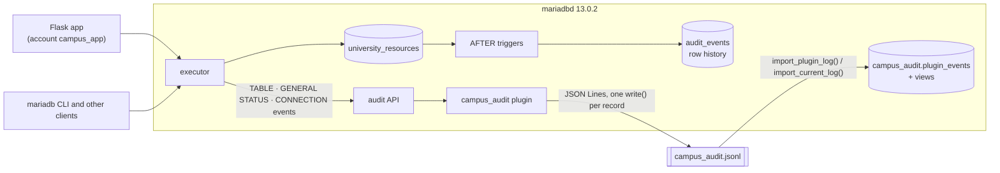
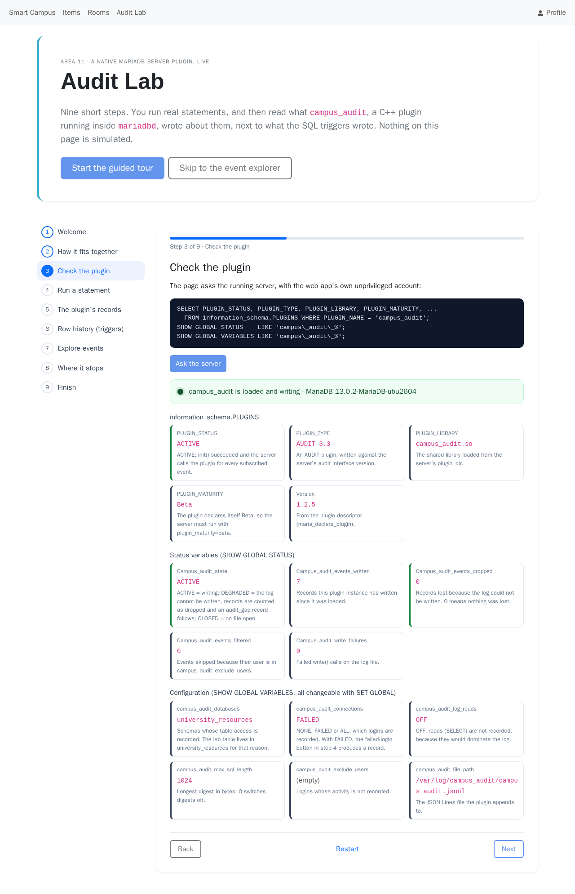
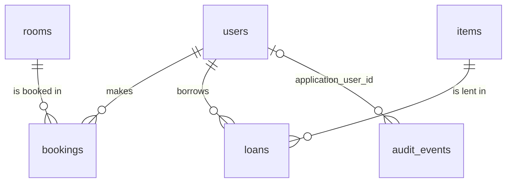

A project for area 11, "Write a server plugin" for the [MariaDB student database projects, 2026-09](https://mariadb.org/bachelor_hackathon_2026-09/).

# Smart Campus: a MariaDB audit plugin for a university resource system

**`campus_audit`** is a native MariaDB server plugin (C++11, `MYSQL_AUDIT_PLUGIN`, audit interface
`0x0303`). It runs *inside* `mariadbd` and records **who touched which table, with which statement,
and whether the statement worked**, for every client of the server. No password, literal or row
value is copied into its log. A Flask web application, **Smart Campus**, uses the database: students
book rooms and borrow equipment. Its **Audit Lab** (`/lab`) runs statements and shows the plugin's
real records next to the row history written by SQL triggers.

| | |
|---|---|
| Assignment | MariaDB student database projects 2026-09, **area 11: write a server plugin** |
| Server | **MariaDB 13.0.2** (Docker image `mariadb:13.0.2-resolute`, pinned by digest; official Windows zip). Also built and tested against **11.8.9** (audit API `0x0302`), in the CI job `server-11-8` on every push |
| Plugin | `campus_audit` **1.2.5**, maturity Beta, 9 system variables, 11 status variables |
| Runs on | Linux with Docker; Windows 11 with Docker Desktop; native Windows with a Zig-built DLL; macOS **not tested** |
| Status | Complete: plugin, tutorial plugin, database, web application, guided tours, tests and documentation |


**Start here:**

| You want to | Do this |
|---|---|
| see the plugin work, nothing else (10 minutes, Docker only) | `make plugin-lab` (Windows: `.\frantastic.cmd plugin-lab`), then [plugin/README.md](plugin/README.md) |
| write your own audit plugin | the [skeleton plugin](examples/skeleton_plugin/README.md): about 50 lines of code, a 15-minute walkthrough |
| run the whole application | [Quick start](#quick-start): `make up`, `make demo`, then the tour at `/lab` |
| know why it works the way it does | [Experimental findings](#experimental-findings), [docs/plugin-api-notes.md](docs/plugin-api-notes.md), [docs/experiments.md](docs/experiments.md) |

## Contents

[Why a server plugin](#why-a-mariadb-server-plugin) · [What the plugin records](#what-the-plugin-records) ·
[Architecture](#architecture) · [Experimental findings](#experimental-findings) ·
[Quick start](#quick-start) · [Verify that it works](#verify-that-it-works) · [Features](#features) ·
[Demonstration and Audit Lab](#demonstration-and-audit-lab) · [SQL examples](#sql-examples) ·
[Database design](#database-design) · [Setup in detail](#setup-in-detail) · [Tests](#tests) ·
[Security](#security) · [Known limitations](#known-limitations) · [Design decisions](#design-decisions) ·
[Lessons learned](#lessons-learned) · [Troubleshooting](#troubleshooting) · [Cleanup](#cleanup) ·
[Repository layout](#repository-layout) · [Team](#team) · [Documentation](#documentation)

## Why a MariaDB server plugin

The audit API (`include/mysql/plugin_audit.h`) is the server's supported way to observe
connections, statements and table access from inside `mariadbd`, for every client. Application
code cannot do this: it does not see other clients, failed logins, DDL, or statements that never
reach it. Triggers cannot either: they see neither refused nor failed statements. A plugin needs no
patched server. It is a shared library loaded at run time (`INSTALL SONAME`), with a versioned
interface, a maturity check, its own system and status variables, and *services* through which it
calls back into the server.

The API in one screen (every fact is labelled doc / header / source / observed in
[docs/plugin-api-notes.md](docs/plugin-api-notes.md)):

- A plugin declares itself with `maria_declare_plugin` and a `st_mysql_audit` descriptor: an
  interface version, a mask of event classes and one callback, `event_notify(thd, event_class, event)`.
- `campus_audit` subscribes to **CONNECTION** (connect, disconnect, change user), **TABLE** (a table
  opened for read or write, create, drop, rename, alter) and **GENERAL** (only the STATUS subclass,
  which arrives after the client has its answer).
- The callback returns `void`: a plugin can observe but never veto. Auditing through this API is
  **fail-open**, so the plugin's job is to make every loss visible.
- No event carries row data, a commit or the SQL command type, and TABLE events are raised when a
  table is *opened*, before the statement runs. These boundaries shaped the design.
- MariaDB's "Audit Plugin Development" page contained only a title and a one-sentence summary
  (retrieved 2026-11-15). The authoritative description is the header shipped with the server,
  which the notes quote.

## What the plugin records

| Record | Source event | Content |
|---|---|---|
| `table_write`, `table_read` (optional), `table_create`, `table_alter`, `table_rename`, `table_drop` | TABLE | schema, table, account, host, IP, connection id, query id; watched schemas only |
| `statement` | GENERAL STATUS | the outcome (`error_code`) of every statement that touched a watched table, or was refused by the privilege system (`access_denied`), or, with scope `SESSION`, raised no table event; a digest with **every literal replaced by `?`** |
| `connect_failed`, `change_user_failed` (default); `connect`, `disconnect`, `change_user` (optional) | CONNECTION | user (for CHANGE_USER: the account *before* the switch), host, IP, error code |
| `config_change`, `plugin_start`, `plugin_stop`, `audit_gap` | the plugin itself | configuration changes (attributed to the `SET GLOBAL`), life cycle, **announcements of lost records** |

The `statement` record of an `INSERT` that violated a CHECK constraint, copied from the plugin-lab
run [`docs/evidence/cycle9/14-plugin-lab-plugin-1.2.5-docker-desktop.txt`](docs/evidence/cycle9/14-plugin-lab-plugin-1.2.5-docker-desktop.txt)
(the literals `2, 'invalid', 0` became `?`):

```json
{"ts":"2026-11-21T05:04:10.255776Z","seq":7,"instance":"660c24a7e5797-1","event":"statement","conn":14,"query_id":26,"account":"root[root] @ localhost []","db":null,"command":"Query","error_code":4025,"status":"error","sql_digest":"INSERT INTO lab.notes VALUES (?, ?, ?)","sql_digest_truncated":false}
```

More real records: [`docs/evidence/sample-records.jsonl`](docs/evidence/sample-records.jsonl). A
missing value is `null`, never invented.

**Configuration.** All variables are global, and all but the last are dynamic (`SET GLOBAL`). The
three list and path variables (`file_path`, `databases`, `exclude_users`) and `reopen_now` have a
check function: an invalid value is refused with ER 1231, the reason is in `SHOW WARNINGS`, and the
previous value stays in force. The server itself validates the `ENUM` and `BOOL` variables (ER 1231
without a plugin reason), and it clamps an out-of-range `max_sql_length` with a warning.

| Variable | Default | Meaning |
|---|---|---|
| `campus_audit_file_path` | `campus_audit.jsonl` | JSON Lines file, relative to the data directory. A new path is opened first and the old file stays if that fails. Only `.jsonl` files of the server's own that are empty or campus_audit logs, with no link; on Linux also a FIFO of the server's user, `/dev/null` and `/dev/full` ([details](docs/security.md#which-files-the-audit-log-may-be)) |
| `campus_audit_databases` | `university_resources` | comma-separated schemas, or `*` (all except `mysql`, `sys`, `information_schema`, `performance_schema`) |
| `campus_audit_exclude_users` | empty | logins whose activity is not recorded (exact match) |
| `campus_audit_log_reads` | `OFF` | also record read access (needed for `CREATE TRIGGER`, `DROP TRIGGER`, `CREATE VIEW`, which the server reports as reads) |
| `campus_audit_connections` | `FAILED` | `NONE`, `FAILED` or `ALL` |
| `campus_audit_statement_scope` | `TABLES` | `SESSION` also records statements without a table event (DML under `LOCK TABLES`, `DROP VIEW`, routine DDL, `COMMIT`, `ROLLBACK`, `SET`) when the session's default schema is watched or its last table access was to a watched table |
| `campus_audit_max_sql_length` | `1024` | digest length 0–8192 bytes; 0 = no digest |
| `campus_audit_reopen_now` | `OFF` | `SET ... = ON` closes and reopens the file (log rotation) |
| `campus_audit_readable_by_all` | `OFF` | startup option: new log files readable by all, which `LOAD_FILE()` requires on Linux; protect the directory instead (`ON` in the Docker image, directory `0750 mysql:mysql`) |

Status variables: `Campus_audit_state` (`ACTIVE`, `DEGRADED`, `CLOSED`, or `BUSY` when the log is
held longer than a status query may wait), `_file`, `_last_error`, `_events_written`,
`_events_dropped`, `_events_filtered`, `_events_unexpected`, `_write_failures`, `_open_failures`,
`_reopens`, `_bytes_written`.

## Architecture



Two mechanisms observe the same statement and are combined on purpose, because each sees what the
other cannot:

| | Plugin (`campus_audit`) | Triggers (`database/triggers.sql`) |
|---|---|---|
| Sees | every client; failed logins; DDL; statements that were rejected, refused or rolled back; the outcome | old and new column values of each changed row; the application user |
| Cannot see | row values (the audit API carries none) | failed or refused statements, logins, DDL, other schemas |
| Stored in | a file, imported into `campus_audit.plugin_events` | `university_resources.audit_events` |
| Joined by | connection id (`conn` = `audit_events.connection_id`), table and time | |

Per statement, each table the server opens raises a TABLE event. If it passes the schema and user
filters, it becomes a `table_*` record. The GENERAL STATUS event after the statement then produces
one `statement` record with the error code and the digest. Plugin internals, the Audit Lab's request
flow and the full schema: [docs/architecture.md](docs/architecture.md). The plugin's source, file by
file: [plugin/README.md](plugin/README.md#the-source-file-by-file).

## Experimental findings

Each finding was measured on MariaDB 13.0.2 with a reproducible setup. Expectation and observation
are recorded in [docs/experiments.md](docs/experiments.md) (36 experiments).

- **The plugin sees the outcome; triggers do not.** A CHECK-violating `INSERT` produces a
  `table_write` record (the table was opened) and a `statement` record with `error_code 4025`; no
  trigger runs. A rolled-back `UPDATE` is recorded as `ok`, because the API reports statements, not
  commits.
- **Refused statements raise no table event.** The privilege check runs before any table is opened,
  so a refused `DELETE` (ER 1142) is visible only in GENERAL STATUS. It names no table, so the plugin
  attributes the refusal by the session's default schema (`access_denied`).
- **`LOCK TABLES` hides DML from every audit plugin's table events**, exactly as the header says.
  Scope `SESSION` records such statements from GENERAL STATUS without parsing SQL.
- **Trigger DDL looks like a read.** `CREATE TRIGGER`, `DROP TRIGGER` and `CREATE VIEW` arrive as a
  read lock; `DROP VIEW` raises no table event at all. A trigger's body arrives as a statement of its
  own, with its own query id, before the statement that fired it.
- **CHANGE_USER names the old account, even when it fails**, so the account somebody tried to become
  never reaches an audit plugin.
- **Statement correlation holds under the thread pool.** With `thread_pool_size=2` (two thread
  groups; the pool grew to 14 worker threads for 12 connections), 360 `SET GLOBAL`s gave 360
  correctly attributed records and no stray one (`make test-threadpool`). This is an observation,
  not a promise of the API. The test does not record OS thread ids, so it does not show that a
  statement's events ever moved between threads; the design assumes only that one statement runs
  on one thread up to its STATUS event.
- **A stalled log stopped the whole server in 1.2.0.** With the log on a FIFO whose reader stopped,
  a `SET GLOBAL campus_audit_*` waited for the log while the server held
  `LOCK_global_system_variables`, and every login stopped with it. Since 1.2.1 the plugin waits for
  the log only for a bounded time while the server holds a lock. Since 1.2.2 check functions open
  files and configuration records are written by the statement's own STATUS event, which the server
  sends after the client has its answer (experiment 32, `make test-stalled-log`).
- **The audit log path was a write primitive.** Up to 1.2.3, `campus_audit_file_path` (which needs
  `SYSTEM_VARIABLES_ADMIN`, not `FILE`) appended to any file the server could write. Every decision
  is now made on the opened descriptor or handle (experiment 33, `make test-log-path-safety`).
- **An administrator can silence any audit plugin with one statement** (`UNINSTALL SONAME`). Loaded
  at startup as `FORCE_PLUS_PERMANENT`, the plugin cannot be unloaded (ER 1702), and the only remaining
  way to narrow it, `SET GLOBAL`, is recorded (experiment 34, [docs/security.md](docs/security.md#tamper-evidence-not-tamper-proof)).
- **Two gaps that independent reviews found in 1.2.4, fixed in 1.2.5.** A redirect of the log (to
  `/dev/null`, say) was recorded only in the new file; now the old log records it too, without I/O
  under a server lock (experiment 35). Executable comments (`/*!100000 DELETE ... */`), which the
  server runs, were dropped from the digest; now their content is kept, with its literals masked
  (experiment 36).
- **Two bugs only Linux could show** (found by CI, fixed in 1.1.1): a self-deadlock on
  `LOCK_global_system_variables` from a session-variable access inside a `SET GLOBAL` callback, and
  `LOAD_FILE()` refusing files that are not readable by all.
- **Against the built-in `server_audit`:** both record the return code. `server_audit` wrote a
  password-hash `UPDATE` verbatim, while `campus_audit` masked every literal, at about three times
  the log volume per audited `INSERT`. On a laptop the timing noise was larger than the difference.

## Quick start

You need **Docker with Compose V2**. On Linux you also need GNU make and bash; on Windows nothing
else (the launcher is PowerShell 5.1, which Windows ships). No compiler, MariaDB or Python is needed
on the host: the plugin is compiled inside the image against the headers of the exact server version.

| Step | Linux | Windows (PowerShell, in the project folder) |
|---|---|---|
| 1. Clone | `git clone https://github.com/rmoraru26/DB_Project_2026.git`, then `cd DB_Project_2026` | the same two commands, one after the other |
| 2. The plugin alone (optional) | `make plugin-lab`: a throw-away server with only the plugins, a guided tour with 25 checks | `.\frantastic.cmd plugin-lab` |
| 3. Build and start everything | `make up` (creates `.env` with random secrets, mode 0600) | `.\frantastic.cmd up` (owner-only ACL) |
| 4. Verify | `make doctor` | the launcher verifies each step itself; `docker compose ps` |
| 5. Demonstrate | `make demo`, then open the address printed by step 3 | `.\frantastic.cmd demo` |
| 6. Test | `make test` | `.\frantastic.cmd test` |

Step 3 builds MariaDB 13.0.2 with the plugin (its unit tests run during the build), initialises the
database, installs the plugin, starts the web application and ends like this:

```text
-> campus_audit plugin: ACTIVE
First local administrator was provisioned and verified. Credential saved in .admin-credentials (not displayed).
Demo student was created and verified (role: student).
Web app:      http://127.0.0.1:5080
Guided tour:  http://127.0.0.1:5080/lab
```

**Logging in.** The repository contains no password. The first start generates two accounts for this
installation only. Each password is stored in a private, git-ignored file in the project folder,
with two lines: the e-mail address and the password (`cat .demo-credentials`; Windows:
`notepad .demo-credentials`). A restart never changes them, and you can register your own account
at `/register`.

| File | Account | Role | Use it for |
|---|---|---|---|
| `.demo-credentials` | `demo.student@frantastic.local` | student | the booking pages and the Audit Lab |
| `.admin-credentials` | `admin@frantastic.local` | administrator | additionally the change history at `/admin/audit` |

## Verify that it works

```sql
SELECT PLUGIN_NAME, PLUGIN_STATUS, PLUGIN_TYPE, PLUGIN_LIBRARY, PLUGIN_AUTH_VERSION, PLUGIN_MATURITY
  FROM information_schema.PLUGINS WHERE PLUGIN_NAME = 'campus_audit';
-- campus_audit | ACTIVE | AUDIT | campus_audit.so | 1.2.5 | Beta
SHOW GLOBAL VARIABLES LIKE 'campus_audit%';    -- 9 rows
SHOW GLOBAL STATUS LIKE 'Campus_audit%';       -- 11 rows; Campus_audit_state = ACTIVE, events_dropped = 0
```

`make sql` opens a root SQL shell in the container, and `make logs` shows the last records of the
file. `make demo` shows the plugin as `campus_audit | ACTIVE | AUDIT | campus_audit.so | Beta`. It
then causes a booking, a rejected `INSERT` and a failed login, and prints what the plugin recorded
for each. `make doctor` checks `.env`, the containers, both database logins, the plugin, the Audit
Lab objects, the row-history triggers and the generated accounts, and says what to do about anything
that is wrong. `make help` lists every target. Expected results of every suite: [Tests](#tests).

## Features

- **The plugin** `campus_audit`: table access and DDL in watched schemas, the outcome of each
  statement, refused statements, failed logins and its own configuration changes, as JSON Lines with
  literal-free digests. It has validated run-time configuration and 11 status variables, and it is
  fail-open, with losses counted and announced. It builds on Linux and Windows and against audit API
  `0x0302` and `0x0303`.
- **A tutorial plugin** of about 50 lines with a walkthrough, and `make plugin-lab`, which runs both
  plugins in a server that holds nothing else.
- **The database** `university_resources` (users, rooms, items, bookings, loans, row history), with
  keys, CHECK constraints, AFTER triggers and eight idempotent migrations. A separate schema
  `campus_audit` imports the plugin's log with SQL and joins it with the row history.
- **The web application** (Flask on waitress): booking with transactional overlap protection,
  accounts, an administrator's change history and the nine-step **Audit Lab**. It uses one
  least-privilege database account, CSRF tokens and login throttling.
- **One-command setup** on Linux and Windows with generated secrets, an upgrade path for existing
  volumes, `make doctor`, `make repair-credentials` and `make rotate-log`.

## Demonstration and Audit Lab

The web application's `/lab` is a nine-step tour. Steps 1, 2 and 8 work without an account; the live
steps need a login (the demo student is enough).

| Step | You see | Where it comes from |
|---|---|---|
| 1–2 | what an audit plugin is; how the parts fit together | explanation and diagram |
| 3 | the plugin's state, counters and configuration | `information_schema.PLUGINS`, `SHOW GLOBAL STATUS` / `VARIABLES` |
| 4 | seven buttons, each one fixed statement: insert, update, delete, invalid insert, update + ROLLBACK, forbidden statement, failed login | `frontend/lab.py`, on the disposable table `audit_lab_notes` |
| 5–6 | the plugin's records of that statement, every field explained; the trigger's row history of the same statement | `CALL campus_audit.import_current_log()`, then both tables by connection id |
| 7 | an explorer with filters (event type, table, outcome, account, time) | students see their own actions, administrators everything |
| 8–9 | where the plugin's view ends, each limit reproducible in step 4; a summary | |

| Plugin state | Row history next to the plugin | Refused statement in the explorer |
|---|---|---|
|  |  |  |

More screenshots: [home](docs/screenshots/01-home.png), [architecture step](docs/screenshots/02-architecture.png),
[insert result](docs/screenshots/04-insert-result.png), [CHECK violation](docs/screenshots/07-check-violation.png),
[limits](docs/screenshots/09-limits.png), [phone width](docs/screenshots/10-phone.png). The browser
tests write them; the page inventory and visual checklist are in [docs/visual-qa.md](docs/visual-qa.md).
The browser never sends SQL, only an action name. **Booking:** after logging in, *Items* and *Rooms*
offer a calendar of free hourly slots between 09:00 and 22:00, and *My bookings* lists and cancels
reservations.

## SQL examples

Seven short files in [`examples/`](examples/README.md), meant to be run in order (`make examples`):
install and verify, cause events, read the log, configure and break it, unload, a second plugin, and
what table events miss.

A rejected statement still opens its table, so the plugin records the attempt *and* the outcome.
From `examples/02_cause_events.sql` and `03_read_the_log.sql`; the output is shortened from a real run
([`docs/evidence/cycle3/linux-13.0.2/21-make-examples.txt`](docs/evidence/cycle3/linux-13.0.2/21-make-examples.txt)):

```sql
INSERT INTO rooms (name, capacity) VALUES ('Broken room', 0);
-- ERROR 4025 (23000): CONSTRAINT `chk_rooms_capacity_positive` failed for `university_resources`.`rooms`
CALL campus_audit.import_plugin_log(@@GLOBAL.campus_audit_file_path);
SELECT event_type, table_name, statement_error_code AS err, sql_digest
  FROM campus_audit.v_table_activity ORDER BY event_time DESC LIMIT 6;
-- table_write | rooms | 4025 | INSERT INTO rooms (name, capacity) VALUES (?, ?)
```

## Database design



`database/schema.sql` defines six tables with primary and foreign keys, unique e-mail addresses and
asset tags, CHECK constraints (capacity, time order, loan state consistency, JSON validity) and
indexes for the reservation and history queries. Eight idempotent migrations add the trigger-owned
row history with its `connection_id` (the join key to the plugin's records), the separate
`campus_audit` schema with the import procedures and views, and the Audit Lab objects. They also add
the local administrator gate and the demo-student procedures. `triggers.sql` never copies
`users.password_hash`, and `app_account.sh` creates the least-privilege account from a password
*hash*. The same scripts upgrade an existing database (`make migrate`). Overlapping bookings are
prevented with `SELECT ... FOR UPDATE` in one transaction. The full schema and the migrations in
order are in [docs/architecture.md](docs/architecture.md#database-schema); the reasons are in
[docs/design-decisions.md](docs/design-decisions.md).

## Setup in detail

| Component | Version | Where it is fixed |
|---|---|---|
| MariaDB server | 13.0.2 (also tested: 11.8.9) | `docker/mariadb/Dockerfile` (image digest); CI downloads the Windows zip by SHA-256 |
| Plugin headers | `libmariadbd-dev` and `libmariadb-dev` of exactly the server's version | `docker/mariadb/Dockerfile` |
| Python (web image) | 3.13.17 | `frontend/Dockerfile` |
| Flask, Werkzeug, PyMySQL, python-dotenv, waitress | 3.1.3, 3.1.9, 1.2.3, 1.2.4, 3.0.2 | `frontend/requirements.txt` |
| pytest, Playwright | 9.1.1, 1.55.0 | `frontend/requirements-dev.txt`, `frontend/requirements-browser.txt` |
| Zig (native Windows build only) | 0.16.0 | `.github/workflows/ci.yml` (SHA-256) |

- **Docker, Linux or Windows.** `make up` and `.\frantastic.cmd up` are safe to repeat: they apply
  the migrations to an existing volume and keep all data and both credentials. Ports 3307 (MariaDB)
  and 5080 (web) are bound to `127.0.0.1` only (`MARIADB_PORT` / `WEB_PORT` in `.env`). Every step as
  a plain `docker compose` command, the Windows launcher and recovery: [docs/docker.md](docs/docker.md).
- **The plugin on your own server, without Docker** (Linux headers, or Windows with Zig): build it,
  copy it into `@@plugin_dir`, set `plugin_maturity=beta` under `[mysqld]`, restart, then
  `INSTALL SONAME 'campus_audit'`. The commands are in [plugin/README.md](plugin/README.md#build-and-install-it-without-docker).
  For the database and web application on that server: `bash scripts/setup_database.sh`,
  `bash scripts/demo.sh` and `python frontend/app.py`. This whole path was run on Ubuntu with the
  MariaDB 13.0.2 packages, without the project's Docker build ([evidence](docs/evidence/cycle2/01-native-linux-install.txt)).

## Tests

```bash
make plugin-lab         # the plugin alone in a throw-away server: 25 checks
make test               # after make up: 8 suites in the test-runner container (unit, repository,
                        #   shell, plugin end-to-end, database, web application)
make test-integration   # host-level: credential life cycle, log rotation, thread pool, stalled log, log path safety
make test-server-version MARIADB_IMAGE=mariadb:11.8@sha256:d36f18d65a0459510b8b0f643b226a6d299e3206486e2b64ff20754a6d291707   # the plugin tests on another server version
make test-browser       # Playwright against the running stack
make mutation           # injects 80 bugs into the plugin code; the unit tests must catch each
```

Latest results. Each row names where the suite ran; the raw outputs are in `docs/evidence/`.

| Suite | Result | Where |
|---|---|---|
| Plugin unit tests, 7 programs | 225 checks as root; 223 + 1 skipped as a normal user (giving a file away needs root) | Linux; CI also on native Windows (Zig build) |
| Mutation check | 80 of 80 injected bugs caught | Linux, CI |
| Plugin lab (`make plugin-lab`) | 25 passed, 0 failed (24 before the handover check of 1.2.5) | Docker Desktop on Windows (script and launcher), CI on Linux |
| End-to-end harness; thread pool; stalled log; log path safety | 144 / 30 / 19 / 39 + 2 passed, 0 failed, on **13.0.2 and 11.8.9** (plugin 1.2.5) | throw-away containers (`make test-server-version`), CI |
| Permanent load (`make test-permanent-load`, experiment 34) | 5 passed, 0 failed | throw-away container, CI |
| End-to-end harness, native Windows | all checks pass except the two Linux-only ones (`/dev/full`, `/dev/null`), incl. CHANGE_USER; the skeleton DLL loaded next to it | CI job on native Windows MariaDB 13.0.2 |
| Database tests (8 scripts); web application and Audit Lab | all pass; 332 passed, 1 skipped (the browser module) | test-runner container, CI |
| Credential life cycle; log rotation; log import limits | 19 / 8 / 13 checks | Linux host driving the stack, CI |
| Browser tests | 11 passed, incl. no horizontal scroll at 390 px (CI); every page at three widths with 0 px overflow and 0 console errors was a separate local scan (`docs/evidence/phase1/final-verification/`) | Playwright |
| Windows launcher (PowerShell 5.1) | 10 + 98 + 18 + 37 checks (the hardening suite reports 98; it prints 99 PASS lines); ACL test 8, also in CI as a throw-away standard user | Windows 11, CI |

GitHub Actions runs four jobs on every push and pull request: static checks, the Docker end-to-end
job, MariaDB 11.8.9, and native Windows. The runs, the commits they tested, what was not run and
why, and the history of every earlier cycle are in [docs/testing.md](docs/testing.md). Not
verified: macOS, and a physical Linux host. On the development PC, Smart App Control blocks freshly
built unsigned test programs, so native Windows results come from CI.

## Security

- **No secret in the repository.** `.env`, `.admin-credentials` and `.demo-credentials` are generated
  per installation, private and git-ignored; `scripts/check_repo.py` fails the build if one is
  tracked or its ignore rule disappears.
- **Generated accounts.** Passwords come from Python's `secrets` module, are hashed with Werkzeug,
  and reach MariaDB only as hashes, through definer procedures the web account cannot execute.
  `make reset-demo` and `make reset-admin` issue new ones.
- **The log contains no literal:** no password, hash or row value, also not under
  `NO_BACKSLASH_ESCAPES`.
- **The log path cannot be used to write into or expose foreign files** (1.2.4). The checks are made
  on the opened file, with the rules for Linux and Windows in
  [docs/security.md](docs/security.md#which-files-the-audit-log-may-be).
- **Least privilege.** The web application uses only `campus_app`: no FILE, no DDL, column-level
  grants, parameterised SQL. CSRF tokens, login throttling, `HttpOnly` and `SameSite=Lax` cookies.

The threat model, and what the log *does* contain, are in [docs/security.md](docs/security.md).

## Known limitations

- **Fail-open by API design.** A full disk or a locked file loses records; they are counted and
  announced (`audit_gap`), never prevented. Fail-closed auditing needs triggers.
- **Coverage of the default configuration.** DML under `LOCK TABLES`, view and routine DDL, `COMMIT`
  and `ROLLBACK` need scope `SESSION`; trigger DDL and `CREATE VIEW` need `log_reads = ON`. Even then,
  table-less DDL with a qualified name, from a session whose default schema is not watched, leaves
  no record: the API names no object for it. A refused statement is attributed by the default schema.
- **Scope `SESSION` is noisy and cannot classify.** It also records `SET` and `SELECT 1`, and under
  `LOCK TABLES` it cannot tell a read from a write.
- **No row values, no commit information, no target of CHANGE_USER, no tables of a refused
  statement:** the audit API does not deliver them.
- **The import reads the whole file** with `LOAD_FILE()`, limited by `max_allowed_packet`. Rotate
  with `make rotate-log`; an oversized file is imported in parts ([docs/docker.md](docs/docker.md#log-rotation-and-the-size-limit)).
  There is no automatic rotation.
- **One unbuffered `write()` per record, no `fsync`**, in the statement's own thread. A destination
  that hangs without failing makes audited statements wait; the rest of the server keeps answering.
- **The log's directory is not restricted**, the owner is not checked on Windows, and an older
  campus_audit log of the same OS user is accepted ([docs/security.md](docs/security.md#which-files-the-audit-log-may-be)).
- **What the redirect handover does not cover.** The log that is left gets the `config_change`
  record, not the attributed `statement` record; that one, with the account, goes to the new
  destination. A `SET GLOBAL` with no STATUS event of its own (one run by the event scheduler, or
  inside a stored routine) is recorded only when the session's next STATUS or DISCONNECT event
  arrives. Neither was tested.
- **Excluded users are excluded everywhere.** `campus_audit_exclude_users` also hides the failed
  logins of those names, so password guessing against an excluded service account leaves no record.
- **Schema names are matched case-insensitively**, also on a case-sensitive server
  (`lower_case_table_names = 0`): watching `lab` also records `Lab`. This errs towards recording
  more. Only the system schemas `mysql` and `sys` are matched by exact case.
- **Names and digests.** Filter names are limited to `A-Z a-z 0-9 _ $ -` (plus `. @` for users),
  16 entries of at most 128 characters. The digest lexer assumes an ASCII-compatible character set.
- **Platforms and scope.** macOS is untested, and the Linux host scripts use GNU `stat` and `mv`. The
  demo is meant for one machine on `127.0.0.1` (login throttling is per process).

## Design decisions

The reasoning, alternatives and evidence for each are in [docs/design-decisions.md](docs/design-decisions.md).

1. **A file, not a table, as the plugin's sink.** Writing to tables from inside an audit callback
   would re-enter the server while it holds locks, and a file also survives a rollback.
2. **Plugin and triggers together**, joined by connection id, because neither alone answers "who
   changed what, and did it work".
3. **Digests instead of SQL text**, so the audit log is not a second copy of the data.
4. **Fail open and say so**: counters, a `DEGRADED` state and `audit_gap` records.
5. **No SQL parsing in the plugin.** Scope `SESSION` uses only facts the events carry, and it is
   opt-in because of its volume.
6. **Normally no log I/O while the server holds a lock**: check functions open, and the STATUS event writes. Recovery paths (a reopen, an `audit_gap` marker, a file the check could not stage) still write under `LOCK_global_system_variables`, with a 2 s bound.
7. **Generated credentials instead of a shared demo password.**

## Lessons learned

- **Run it where it will run.** Two serious plugin bugs appeared only on Linux; CI on both platforms
  found them within a day.
- **A skipped test looks exactly like a passing one.** A recipe that read a credential from the
  terminal silently skipped the administrator tests in CI. Such skips now fail loudly.
- **Measure the API instead of trusting a summary of it.** "Trigger DDL raises no event" turned out
  to be wrong: it raises a *read* event.
- **Locks you cannot see are still yours.** A plugin callback that waits for its own mutex can stop
  a server that holds a global lock around it (experiment 32).
- **Keep what you cannot prevent visible.** Because the API cannot veto a statement, the useful
  question is not "can records be lost" but "does the log say when they were".

## Troubleshooting

| Symptom | Cause and fix |
|---|---|
| `ERROR 1045 ... 'root'@'localhost'`, or the web app cannot reach its database | the volume keeps the passwords of an earlier `.env`: `make doctor`, then `make repair-credentials` (keeps data) |
| `post_start: the campus_audit plugin is not ACTIVE` | the lines below it give the plugin's reason, for example a log file the server cannot open |
| `ERROR 1231 Variable 'campus_audit_...' can't be set` | `SHOW WARNINGS` gives the reason |
| `Campus_audit_state = DEGRADED` | see `Campus_audit_last_error`; `SET GLOBAL campus_audit_reopen_now = ON` retries at once |

Every other symptom: [docs/docker.md](docs/docker.md#troubleshooting).

## Cleanup

`make down` (`frantastic.cmd down`) stops the containers and keeps all data. `make reset` **deletes**
the database and audit-log volumes; the two credential files stay. `make plugin-lab-down` removes the
plugin-lab container. On a native server, as root:

```sql
UNINSTALL SONAME 'campus_audit';
DROP DATABASE IF EXISTS campus_audit;
DROP DATABASE IF EXISTS university_resources;
DROP USER IF EXISTS 'campus_app'@'%', 'audit_lab_intruder'@'%';
```

## Repository layout

```text
plugin/            the campus_audit plugin: src/, tests/, lab/ (the plugin-only tour), README.md, Makefile
examples/          seven runnable SQL files and skeleton_plugin/, a tutorial audit plugin
database/          schema.sql, migrations/, triggers.sql, seed.sql, catalogue.sql, app_account.sh
frontend/          Flask app (app.py), Audit Lab (lab.py, templates/, static/), tests/
scripts/           setup, post-start, doctor, credentials, rotation, demo, plugin lab, benchmark, checks
tests/             plugin/ (end-to-end, thread pool, stalled log, log path safety), database/, shell/, integration/, windows/
docker/mariadb/    server image (stages build, test-runner, plugin-server, runtime), server options
docs/              architecture, API notes, design decisions, experiments, security, testing, docker,
                   visual QA, screenshots/, evidence/ (raw outputs of executed runs)
Makefile, frantastic.cmd, frantastic.ps1, compose.yaml, .env.example, .github/workflows/ci.yml
```

## Team

Team **FRANtastic**, four students of the Databases course at Constructor University:
Ruxandra Moraru, Furkan Sacmaci, Norman Viet Casasola Pham and Ahmed Maina Garba (names as in
[`LICENSE`](LICENSE)).

## Documentation

| Document | Content |
|---|---|
| [plugin/README.md](plugin/README.md) | the plugin on its own: the lab, experiments to try, building it, the source file by file |
| [examples/skeleton_plugin/README.md](examples/skeleton_plugin/README.md) | write your first audit plugin |
| [docs/plugin-api-notes.md](docs/plugin-api-notes.md) | every API fact the plugin relies on, with its source; what the events do not deliver |
| [docs/experiments.md](docs/experiments.md) | each experiment: setup, expectation, observation, conclusion |
| [docs/architecture.md](docs/architecture.md) | components, the path of a statement, the schema, the Audit Lab request flow |
| [docs/design-decisions.md](docs/design-decisions.md) | the decisions above, with alternatives and reasons |
| [docs/security.md](docs/security.md) | credentials, privileges, which files the log may be, what it contains, threat model |
| [docs/testing.md](docs/testing.md) | every suite, what it proves, where and when it ran, what was not run, cycle history |
| [docs/docker.md](docs/docker.md) | the Docker workflow step by step, Windows, upgrade, recovery, rotation, troubleshooting |
| [docs/database_testing.md](docs/database_testing.md) | the database team's constraint checks |
| [docs/visual-qa.md](docs/visual-qa.md) | page inventory and the visual review checklist for the website |
| [plugin/docs/error_handling.md](plugin/docs/error_handling.md) | the error types and reporting used inside the plugin |
| [examples/README.md](examples/README.md) | the SQL examples |

Licence: [MIT](LICENSE). The plugin declares `PLUGIN_LICENSE_BSD`, the permissive value of the three
the server's `plugin.h` offers; see [docs/plugin-api-notes.md](docs/plugin-api-notes.md).
