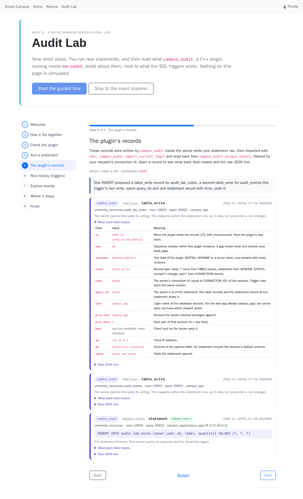
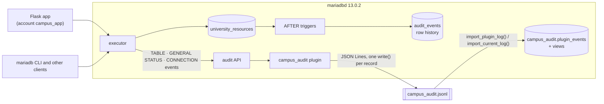
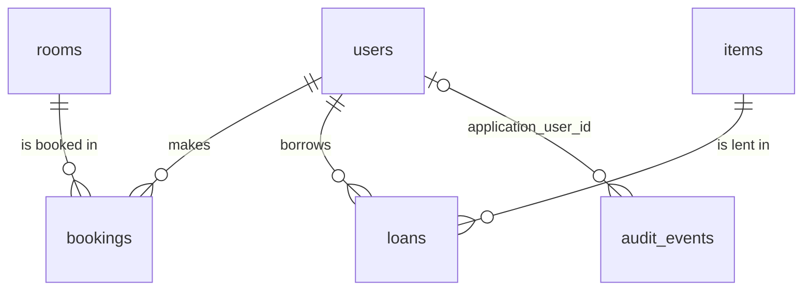
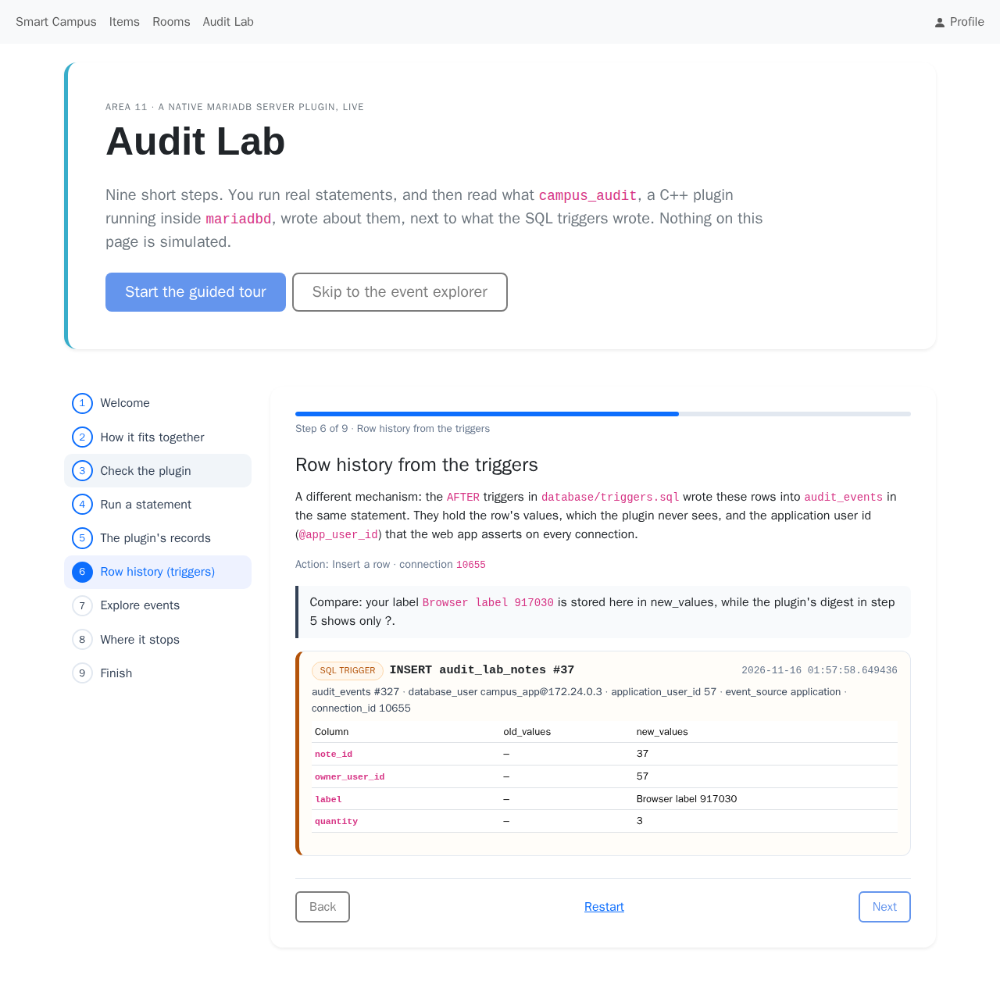
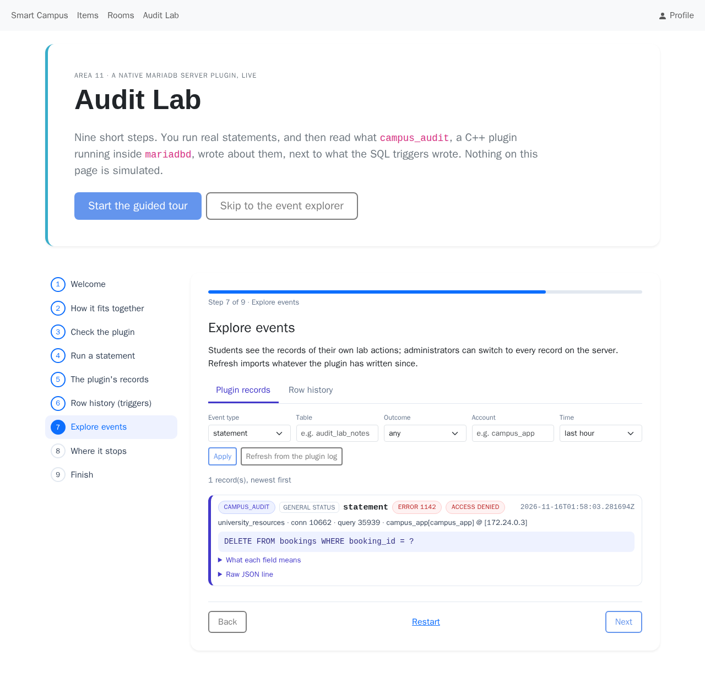

A project for area 11, "Write a server plugin" for the [MariaDB student database projects, 2026-09](https://mariadb.org/bachelor_hackathon_2026-09/).

# Smart Campus: a MariaDB audit plugin for a university resource system

**`campus_audit`** is a native MariaDB server plugin (C++11, `MYSQL_AUDIT_PLUGIN`, audit interface
`0x0303`). It runs *inside* `mariadbd` and records **who touched which table, with which statement,
and whether the statement worked**, for every client of the server, without copying a password, a
literal or a row value into its log. A Flask web application, **Smart Campus** (students book rooms
and borrow equipment), uses the database, and its **Audit Lab** (`/lab`) lets you run statements and
read the plugin's real records next to the row history written by SQL triggers.

| | |
|---|---|
| Assignment | MariaDB student database projects 2026-09, **area 11: write a server plugin** |
| Server | **MariaDB 13.0.2** (Docker image `mariadb:13.0.2-resolute`, pinned by digest; official Windows zip) |
| Plugin | `campus_audit` **1.2.0**, maturity Beta, 9 system variables, 11 status variables |
| Runs on | Linux with Docker; Windows 11 with Docker Desktop; native Windows server with a Zig-built DLL; macOS **not tested**. GitHub Actions (Linux and native Windows jobs) ran green for the Phase 1 commit `5d48de0`, plugin 1.2.0 included, as it did for the baseline `19fd0a2` ([Tests](#tests)) |
| Status | Complete: plugin, database, web application, guided tour, tests and documentation |



## Contents

[Quick start](#quick-start) · [Features](#features) · [Architecture](#architecture) ·
[Why a server plugin](#why-a-mariadb-server-plugin) · [What the plugin records](#what-the-plugin-records) ·
[Database design](#database-design) · [Setup in detail](#setup-in-detail) ·
[Demonstration and Audit Lab](#demonstration-and-audit-lab) · [SQL examples](#sql-examples) ·
[Experimental findings](#experimental-findings) · [Tests](#tests) · [Security](#security) ·
[Known limitations](#known-limitations) · [Design decisions](#design-decisions) ·
[Lessons learned](#lessons-learned) · [Troubleshooting](#troubleshooting) · [Cleanup](#cleanup) ·
[Repository layout](#repository-layout) · [Team](#team) · [Documentation](#documentation)

## Quick start

You need **Docker with Compose V2**. On Linux also GNU make and bash; on Windows nothing else
(the launcher is PowerShell 5.1, which Windows ships). No compiler, MariaDB or Python on the host:
the plugin is compiled inside the image against the headers of the exact server version.

| Step | Linux | Windows (PowerShell, in the project folder) |
|---|---|---|
| 1. Clone | `git clone https://github.com/rmoraru26/DB_Project_2026.git && cd DB_Project_2026` | the same |
| 2. Configure | nothing to do: the next step creates `.env` with random secrets (mode 0600) | the same (owner-only ACL) |
| 3. Build and start | `make up` | `.\frantastic.cmd up` |
| 4. Verify | `make doctor` | the launcher verifies each step itself; `docker compose ps` |
| 5. Demonstrate | `make demo`, then open the address printed by step 3 | `.\frantastic.cmd demo`, then open the address |
| 6. Test | `make test` | `.\frantastic.cmd test` |

Step 3 builds MariaDB 13.0.2 with the plugin (its unit tests run during the build), initialises the
database, installs the plugin, starts the web application and ends like this:

```text
-> campus_audit plugin: ACTIVE
First local administrator was provisioned and verified. Credential saved in .admin-credentials (not displayed).
Demo student was created and verified (role: student).
Demo student login: demo.student@frantastic.local; password on line 2 of .demo-credentials (private local file; not printed).

Web app:      http://127.0.0.1:5080
Guided tour:  http://127.0.0.1:5080/lab
Student login: .demo-credentials (line 1 e-mail address, line 2 password; private local file; not printed)
Administrator credential: .admin-credentials (private local file; not printed)
Next:         make demo
```

**Logging in.** The repository contains no password. The first start generates two accounts for
this installation only and stores each password in a private, git-ignored file in the project folder:

| File | Account | Role | Use it for |
|---|---|---|---|
| `.demo-credentials` | `demo.student@frantastic.local` | student | the booking pages and the Audit Lab |
| `.admin-credentials` | `admin@frantastic.local` | administrator | additionally the change history at `/admin/audit` |

Each file has two lines, the e-mail address and the password: `cat .demo-credentials` (Windows:
`notepad .demo-credentials`). A restart never changes them. You can also register your own account
on `/register`. Details and recovery: [Security](#security).

`make demo` shows the plugin as `campus_audit | ACTIVE | AUDIT | campus_audit.so | Beta`, causes a
booking, a rejected `INSERT` and a failed login, and prints what the plugin recorded for each.
`make doctor` checks, in order, `.env`, the containers, both database logins, the plugin, the
Audit Lab objects, the row-history triggers and the generated accounts, and says what to do about
anything that is wrong. `make help` lists every target.

## Features

- **Audit plugin `campus_audit`** for MariaDB 13.0.2: table access and DDL in watched schemas,
  the outcome of each statement, failed logins, its own configuration changes; JSON Lines output;
  literal-free statement digests; 9 dynamic or startup variables with validation; 11 status
  variables; fail-open with counted and announced losses; opt-in recording of statements the
  server raises no table event for (`campus_audit_statement_scope = SESSION`, new in 1.2.0).
- **Database** `university_resources` (users, rooms, items, bookings, loans, row history) with keys,
  CHECK constraints, AFTER triggers for row history, eight idempotent migrations, and a separate
  schema `campus_audit` that imports the plugin's log with SQL (`LOAD_FILE`, a recursive CTE,
  `JSON_VALUE`) and joins it with the row history in views.
- **Web application** (Flask on waitress): registration and login, room and item booking with an
  hourly calendar and transactional overlap protection, account pages, an administrator's change
  history, a health endpoint; one least-privilege database account, CSRF tokens, login throttling.
- **Audit Lab** (`/lab`): a nine-step guided tour that runs fixed statements and shows the plugin's
  records and the trigger's row history for exactly that statement.
- **One-command setup** on Linux (`make up`) and Windows (`frantastic.cmd up`), with generated
  secrets, an upgrade path for existing volumes, `make doctor`, `make repair-credentials`,
  `make rotate-log`.
- **Tests**: 7 C++ unit-test programs with a mutation check, an end-to-end harness for the loaded
  plugin (Linux and native Windows), database tests, 330+ web application tests, browser tests,
  shell and PowerShell tests of the installation scripts, and host-level tests of the credential
  life cycle, log rotation and the thread pool. CI on Linux and Windows.
- **A tutorial**: a 60-line skeleton audit plugin with a walkthrough, and seven runnable SQL examples.

## Architecture



Two mechanisms observe the same statement and are deliberately combined, because each sees what
the other cannot:

| | Plugin (`campus_audit`) | Triggers (`database/triggers.sql`) |
|---|---|---|
| Sees | every client; failed logins; DDL; statements that were rejected, refused or rolled back; the outcome | old and new column values of each changed row; the application user |
| Cannot see | row values (the audit API carries none) | failed or refused statements, logins, DDL, other schemas |
| Stored in | a file, imported into `campus_audit.plugin_events` | `university_resources.audit_events` |
| Joined by | connection id (`conn` = `audit_events.connection_id`), table and time | |

Per statement: each table the server opens raises a TABLE event, which passes the schema and user
filters and becomes a `table_*` record; the GENERAL STATUS event after the statement then produces
one `statement` record with the error code and a digest. Internals, the request flow of the Audit
Lab and the full schema: [docs/architecture.md](docs/architecture.md).

## Why a MariaDB server plugin

The audit API (`include/mysql/plugin_audit.h`) is the server's supported way to observe
connections, statements and table access from inside `mariadbd`, for every client. Application
code cannot do that: it does not see other clients, failed logins, DDL, or statements that never
reach it. MariaDB makes it possible without patching the server: a plugin is a shared library
loaded at run time (`INSTALL SONAME`), with a versioned interface, a maturity check, its own
system and status variables, and *services* through which it calls back into the server.

**The plugin API in one screen** (every fact is labelled doc / header / source / observed in
[docs/plugin-api-notes.md](docs/plugin-api-notes.md)):

- An audit plugin declares itself with `maria_declare_plugin` and a `st_mysql_audit` descriptor:
  an interface version, a mask of event classes and one callback,
  `event_notify(MYSQL_THD, unsigned int event_class, const void *event)`.
- `campus_audit` subscribes to three classes: **CONNECTION** (connect, disconnect, change user),
  **TABLE** (lock for read or write, create, drop, rename, alter) and **GENERAL** (only the
  STATUS subclass, which arrives after the client has its answer).
- The callback returns `void`: a plugin can observe, never veto. Auditing through this API is
  therefore **fail-open**, and the plugin's job is to make every loss visible.
- No event carries row data, a commit, or the SQL command type; TABLE events are raised when a
  table is *opened*, before the statement runs. These boundaries shaped the whole design.
- MariaDB's official "Audit Plugin Development" page contains only a title and a one-sentence
  summary (retrieved 2026-11-15). The authoritative description is the header that ships with the
  server, which the notes quote.

## What the plugin records

| Record | Source event | Content |
|---|---|---|
| `table_write`, `table_read` (optional), `table_create`, `table_alter`, `table_rename`, `table_drop` | TABLE | schema, table, account, host, IP, connection id, query id; watched schemas only |
| `statement` | GENERAL STATUS | the outcome (`error_code`) of every statement that touched a watched table, or was refused by the privilege system (`access_denied`), or, with scope `SESSION`, raised no table event (`"scope":"session"`); account, default schema, digest with **every literal replaced by `?`** |
| `connect_failed`, `change_user_failed` (default); `connect`, `disconnect`, `change_user` (optional) | CONNECTION | user (for CHANGE_USER: the account *before* the switch), host, IP, error code |
| `config_change`, `plugin_start`, `plugin_stop`, `audit_gap` | the plugin itself | configuration changes (attributed to the `SET GLOBAL` statement), life cycle, **announcements of lost records** |

```json
{"ts":"2026-11-03T15:39:11.312802Z","seq":189,"instance":"65f60ad4a55f4-76b4","event":"statement","conn":621,"query_id":2475,"account":"campus_app[campus_app] @ localhost [127.0.0.1]","db":"university_resources","command":"Query","error_code":0,"status":"ok","sql_digest":"INSERT INTO audit_lab_notes (owner_user_id, label, quantity) VALUES (?, ?, ?)","sql_digest_truncated":false}
```

More real records: [`docs/evidence/sample-records.jsonl`](docs/evidence/sample-records.jsonl).
A missing value is `null`, never invented.

**Configuration.** All variables are global; all but the last are dynamic (`SET GLOBAL`). An
invalid value is refused with ER 1231 and a reason in `SHOW WARNINGS`, and the previous value
stays in force.

| Variable | Default | Meaning |
|---|---|---|
| `campus_audit_file_path` | `campus_audit.jsonl` | JSON Lines file, relative to the data directory; a new path is opened first, the old file stays if that fails |
| `campus_audit_databases` | `university_resources` | comma-separated schemas, or `*` (all except the system schemas `mysql` and `sys`, exact names, and `information_schema` and `performance_schema` in any case; a user schema such as `MySQL` on a case-sensitive server is audited) |
| `campus_audit_exclude_users` | empty | logins whose activity is not recorded (exact match) |
| `campus_audit_log_reads` | `OFF` | also record read access. `CREATE TRIGGER`, `DROP TRIGGER` and `CREATE VIEW` are reported by the server as read access, so they are recorded only when this is `ON` |
| `campus_audit_connections` | `FAILED` | `NONE`, `FAILED` or `ALL` |
| `campus_audit_statement_scope` | `TABLES` | `TABLES`: statements with a recorded table event, and refused ones. `SESSION`: additionally statements for which the server raises no table event (DML under `LOCK TABLES`, `DROP VIEW`, routine DDL, `COMMIT`, `ROLLBACK`, `SET`), when the session's default schema is watched or its last table access was to a watched table |
| `campus_audit_max_sql_length` | `1024` | digest length 0–8192 bytes; 0 = no digest |
| `campus_audit_reopen_now` | `OFF` | `SET ... = ON` closes and reopens the file (log rotation) |
| `campus_audit_readable_by_all` | `OFF` | startup option: make the log readable by all, which `LOAD_FILE()` requires on Linux; protect the directory instead (`ON` in the Docker image, directory `0750 mysql:mysql`) |

Status variables: `Campus_audit_state` (`ACTIVE`, `DEGRADED`, `CLOSED`), `_file`, `_last_error`,
`_events_written`, `_events_dropped`, `_events_filtered`, `_events_unexpected`, `_write_failures`,
`_open_failures`, `_reopens`, `_bytes_written`.

## Database design



`database/schema.sql` defines six tables with primary and foreign keys, unique e-mail addresses
and asset tags, CHECK constraints (capacity, time order, loan state consistency, JSON validity)
and indexes for the reservation and history queries. On top of it, applied in this order by
`scripts/setup_database.sh` and by the Docker initialisation:

| File | What it adds, and why |
|---|---|
| `migrations/001_audit_events_trigger_ownership.sql` | `audit_events` becomes the trigger-owned row history; adds `connection_id`, the join key to the plugin's records |
| `migrations/002_campus_audit_schema.sql` | the separate schema `campus_audit` (`plugin_events`, `import_plugin_log(path)`, views), so the import is not itself audited and the application gets no write access there |
| `migrations/003_audit_lab.sql` | the disposable table `audit_lab_notes`; `import_current_log()`, a definer procedure that gives the application fresh records without the FILE privilege |
| `triggers.sql` | AFTER INSERT/UPDATE/DELETE triggers on all six tables; `users.password_hash` is never copied |
| `seed.sql` | fictional demonstration rows. The three seeded people carry a placeholder instead of a password hash and cannot log in |
| `catalogue.sql` | the 18 item types (three copies each) and five rooms the booking pages offer; inserts only what is missing, never updates a row |
| `migrations/004_remove_shared_admin.sql`, `005_local_admin_bootstrap_state.sql` | no shared administrator: the seeded one is demoted, and a one-time gate with definer procedures creates the local administrator |
| `migrations/006_cancelled_loan_status.sql` | a `cancelled` loan status, so the application never needs DELETE on real tables |
| `migrations/007_local_demo_student.sql` | the generated demo student: a defence-in-depth CHECK constraint that this identity is a student, and procedures that create it or replace its password hash |
| `migrations/008_import_plugin_log_errors.sql` | the import restores the caller's session settings when it fails and explains a log that is too large |
| `app_account.sh` | the least-privilege account `campus_app`, created from a password **hash**; column-level grants on `users`, DELETE only on the lab table |

Every step is idempotent, so the same script upgrades an existing database (`make migrate`).
Overlapping bookings and double loans are prevented with `SELECT ... FOR UPDATE` in one
transaction. Reasons for each decision: [docs/design-decisions.md](docs/design-decisions.md).

## Setup in detail

### Requirements and exact versions

| Component | Version | Where it is fixed |
|---|---|---|
| MariaDB server | 13.0.2 | `docker/mariadb/Dockerfile` (image digest); CI downloads the Windows zip by SHA-256 |
| Plugin headers | `libmariadbd-dev` and `libmariadb-dev` of exactly the server's version | `docker/mariadb/Dockerfile` |
| Python (web image) | 3.13.17 | `frontend/Dockerfile` |
| Flask, Werkzeug, PyMySQL, python-dotenv, waitress | 3.1.3, 3.1.9, 1.2.3, 1.2.4, 3.0.2 | `frontend/requirements.txt` |
| pytest, Playwright | 9.1.1, 1.55.0 | `frontend/requirements-dev.txt`, `frontend/requirements-browser.txt` |
| Zig (native Windows build only) | 0.16.0 | `.github/workflows/ci.yml` (SHA-256) |
| Docker | Engine with Compose V2 | checked by the launchers |

### Linux with Docker

`make up` as in the quick start. It is safe to repeat: it applies the idempotent migrations to an
existing volume, refreshes the application account, installs the plugin if necessary and keeps
all data and both generated credentials. Ports 3307 (MariaDB) and 5080 (web) are bound to
`127.0.0.1` only; change `MARIADB_PORT` / `WEB_PORT` in `.env`. Everything `make` does, as plain
`docker compose` commands: [docs/docker.md](docs/docker.md).

### Windows with Docker Desktop

Install and start Docker Desktop (Linux containers, WSL 2 backend), then in PowerShell:

```powershell
.\frantastic.cmd up          # build, start, initialise, generate the two local accounts
.\frantastic.cmd demo        # cause events and show the plugin's records
.\frantastic.cmd test        # launcher tests, then every suite in the test-runner container
.\frantastic.cmd reset-demo  # issue a new demo-student password (reset-admin for the administrator)
.\frantastic.cmd down        # stop; data is kept
```

The launcher creates `.env`, `.demo-credentials` and `.admin-credentials` with an owner-only ACL
and never prints a secret. The containers are Linux containers; this path tests the Windows
*launcher*, not a Windows build of the plugin.

### Building and installing the plugin yourself

**Linux, without Docker.** Install the headers of your server's version, then:

```bash
make -C plugin test          # 7 unit-test programs, g++ only, no server needed
make -C plugin               # plugin/build/campus_audit.so
```

**Native Windows.** MariaDB 13.0.x for Windows (the zip or MSI contains `include\mysql\server`)
and [Zig 0.16.0](https://ziglang.org/download/); no Visual Studio:

```powershell
powershell -ExecutionPolicy Bypass -File plugin\build_windows.ps1 -MariaDBDir "C:\Program Files\MariaDB 13.0" -Zig C:\tools\zig\zig.exe
```

**Install** (either platform): copy the library to the directory `SELECT @@plugin_dir;` names, put
`plugin_maturity=beta` under `[mysqld]` in the server's option file (the plugin declares itself
Beta, and the server default refuses anything below Gamma; the option is startup-only), restart,
and create the databases from the repository root (Git Bash on Windows):

```bash
export MARIADB_CLIENT="mariadb -h127.0.0.1 -P3306 --skip-ssl-verify-server-cert" MYSQL_PWD='<root password>'
CAMPUS_APP_PASSWORD='<12+ characters of A-Z a-z 0-9 . _ ->' bash scripts/setup_database.sh
bash scripts/demo.sh         # INSTALL SONAME 'campus_audit', events, records
```

On Linux add `loose_campus_audit_readable_by_all = ON` and give the log a directory only the
server's account can enter ([docs/security.md](docs/security.md)). The web application outside
Docker: `pip install -r requirements.txt`, set `DB_HOST`, `DB_PORT`, `DB_USER=campus_app`,
`DB_PASSWORD`, `SECRET_KEY`, then `python frontend/app.py`. The two generated accounts are created
by the Docker launchers only; on a native server use `/register`.

### Verifying the plugin

```sql
SELECT PLUGIN_NAME, PLUGIN_STATUS, PLUGIN_TYPE, PLUGIN_LIBRARY, PLUGIN_AUTH_VERSION, PLUGIN_MATURITY
  FROM information_schema.PLUGINS WHERE PLUGIN_NAME = 'campus_audit';
-- campus_audit | ACTIVE | AUDIT | campus_audit.so | 1.2.0 | Beta
SHOW GLOBAL VARIABLES LIKE 'campus_audit%';    -- 9 rows
SHOW GLOBAL STATUS LIKE 'Campus_audit%';       -- 11 rows; Campus_audit_state = ACTIVE, events_dropped = 0
```

`make sql` opens a root SQL shell in the container; `make logs` shows the last records of the file.

## Demonstration and Audit Lab

The web application's `/lab` is a nine-step tour for newcomers. Steps 1, 2 and 8 work without an
account; the live steps need a login (the demo student is enough).

| Step | You see | Where it comes from |
|---|---|---|
| 1–2 | what an audit plugin is; how the web app, `mariadbd`, the plugin, its log, the import and the triggers fit together | explanation and diagram |
| 3 | the plugin's state: `ACTIVE`, type `AUDIT`, counters, configuration | `information_schema.PLUGINS`, `SHOW GLOBAL STATUS` / `VARIABLES` |
| 4 | seven buttons, each one fixed statement: insert, update, delete, invalid insert, update + ROLLBACK, forbidden statement, failed database login | `frontend/lab.py` on the disposable table `audit_lab_notes` |
| 5 | the plugin's records of that statement, every field explained, and the raw JSON line | `CALL campus_audit.import_current_log()`, then `plugin_events` by connection id |
| 6 | the trigger's row history (old and new values) of the same statement | `audit_events` by connection id |
| 7 | an explorer with filters (event type, table, outcome, account, time) | the same tables; students see their own actions, administrators everything |
| 8–9 | where the plugin's view ends, each limit reproducible in step 4; a summary | |

| Plugin state | Row history next to the plugin | Refused statement in the explorer |
|---|---|---|
|  |  |  |

More screenshots: [home](docs/screenshots/01-home.png), [architecture step](docs/screenshots/02-architecture.png),
[insert result](docs/screenshots/04-insert-result.png), [CHECK violation](docs/screenshots/07-check-violation.png),
[limits](docs/screenshots/09-limits.png), [phone width](docs/screenshots/10-phone.png). They are written by the
browser tests (`SCREENSHOT_DIR`); the page inventory and the visual review checklist are in
[docs/visual-qa.md](docs/visual-qa.md). The browser never sends SQL, only an action name; each
action is one parameterised statement on the caller's own lab rows.

**Booking.** After logging in, *Items* and *Rooms* offer the catalogue (Vacuum … Gameboy, Study
Room … Cinema Room) with a calendar of free hourly slots between 09:00 and 22:00; *My bookings*
lists and cancels reservations. Every booking is one row change you can then look up in step 7 of
the lab or, as administrator, at `/admin/audit`.

## SQL examples

Seven short files in [`examples/`](examples/README.md), meant to be run in order (`make examples`):
install and verify, cause events, read the log, configure and break it, unload, a second plugin,
and what table events miss. A taste:

```sql
-- A rejected statement still opens its table: the plugin records the attempt AND the outcome.
INSERT INTO university_resources.audit_lab_notes (owner_user_id, label, quantity)
VALUES (1, 'invalid', 0);                                   -- ERROR 4025: CHECK constraint failed

CALL campus_audit.import_plugin_log(@@GLOBAL.campus_audit_file_path);
SELECT event_type, table_name, statement_error_code AS err, sql_digest
  FROM campus_audit.v_table_activity ORDER BY event_time DESC LIMIT 2;
-- table_write | audit_lab_notes | 4025 | INSERT INTO university_resources.audit_lab_notes (...) VALUES (?, ?, ?)

-- Record what the TABLE events cannot show (plugin 1.2.0):
SET GLOBAL campus_audit_statement_scope = 'SESSION';
LOCK TABLES university_resources.audit_lab_notes WRITE;
DELETE FROM university_resources.audit_lab_notes WHERE note_id = 0;   -- now recorded, "scope":"session"
UNLOCK TABLES;
SET GLOBAL campus_audit_statement_scope = 'TABLES';
```

**Write your own plugin:** [`examples/skeleton_plugin/`](examples/skeleton_plugin/README.md) is a
60-line audit plugin that counts the events it receives, with a 15-minute walkthrough.

## Experimental findings

Each finding was measured on MariaDB 13.0.2; setup, expectation and observation are in
[docs/experiments.md](docs/experiments.md).

- **The plugin sees the outcome, triggers do not.** A `CHECK`-violating `INSERT` produces a
  `table_write` record (the table was opened) and a `statement` record with `error_code 4025`; no
  trigger runs. A rolled-back `UPDATE` is recorded as `status: ok`: the API reports statements,
  not commits.
- **Refused statements raise no table event.** A `DELETE` the privilege system refuses (ER 1142)
  never opens a table. Since 1.1.0 the plugin records it from GENERAL STATUS (`access_denied`).
- **`LOCK TABLES` hides DML from every audit plugin's table events.** After
  `LOCK TABLES t WRITE` the server raises no table event for `INSERT`, `UPDATE` or `DELETE` until
  `UNLOCK TABLES`, exactly as the header says. The default configuration therefore records
  nothing for them; scope `SESSION` (1.2.0) records them from GENERAL STATUS without parsing SQL.
- **Trigger DDL looks like a read.** `CREATE TRIGGER`, `DROP TRIGGER` and `CREATE VIEW` arrive as
  a table lock with `read_only = 1`; `DROP VIEW` raises no table event; `CREATE PROCEDURE` raises
  one for `mysql.proc` only. A dropped row-history trigger is therefore visible only with
  `campus_audit_log_reads = ON`, which is why `make doctor` verifies that all 18 triggers exist.
- **A trigger's body is a statement of its own.** It gets its own STATUS event and query id,
  before the statement that fired it; its table access is reported under the outer statement.
- **CHANGE_USER names the old account, even when it fails**, so the account somebody tried to
  become never reaches an audit plugin.
- **Statement correlation holds under the thread pool.** With `thread_handling=pool-of-threads`,
  a pool of 2 and 12 connections, 360 `SET GLOBAL` statements gave 360 attributed records and no
  stray one, and 360 statements under `LOCK TABLES` were attributed to the right connection. This
  is an observation, repeated by `make test-threadpool`, not a promise of the API.
- **Two bugs only Linux could show** (found by CI, fixed in 1.1.1): a self-deadlock on
  `LOCK_global_system_variables` from a session variable access inside a `SET GLOBAL` callback,
  and `LOAD_FILE()` refusing files that are not readable by all.
- **Against the built-in `server_audit`** on the same workload: both record the return code;
  `server_audit` wrote a password-hash `UPDATE` verbatim and logged privilege-table writes, while
  `campus_audit` recorded only the watched schema with every literal masked, at about three times
  the log volume per audited `INSERT`. On a laptop the timing noise between passes was larger than
  the difference between the two plugins.

## Tests

```bash
make test               # after make up: 8 suites in the test-runner container (unit, repository,
                        #   shell, plugin end-to-end, database, web application)
make test-integration   # host-level: demo-credential life cycle, log rotation, thread pool
make test-browser       # Playwright against the running stack
make mutation           # injects 65 bugs into the plugin code; the unit tests must notice each
```

Results of the Phase 1 verification (15–17 November 2026) on the working tree based on commit
`19fd0a2`. **Which run is which matters**, so [docs/testing.md](docs/testing.md) separates local
runs, GitHub Actions, manual runs, skipped tests and historical evidence, and
[docs/evidence/phase1/](docs/evidence/phase1/README.md) holds the raw outputs.

| Suite | Result | Where it ran |
|---|---|---|
| Plugin unit tests, 7 programs | 187 checks pass | Linux (g++ in the image build and the test runner) |
| | each of the 7 passed natively in at least one build; Smart App Control blocked other builds of the same programs (not counted as passed) | native Windows (Zig and MSYS2 g++) |
| Mutation check | 67 of 67 injected bugs detected | Linux |
| End-to-end plugin harness | 128 passed, 0 failed, 0 skipped | Linux container, MariaDB 13.0.2 |
| | 119 passed, 0 failed, 1 skipped (`/dev/full`, Linux only) | native Windows MariaDB 13.0.2 with the Zig-built DLL |
| Database tests (8 scripts) | all pass | Linux container; also native Windows |
| Web application and Audit Lab | 332 passed, 1 skipped (browser module) | test-runner container, against MariaDB |
| Demo-credential life cycle; log rotation; log import limits; thread pool | 19 / 8 / 13 / 30 checks pass | Linux host driving the running stack |
| Browser tests; every page at three widths | 11 passed; 48 page views, 0 px overflow, 0 console errors | Playwright container |
| Windows launcher (PowerShell 5.1) | 10 + 98 + 14 + 37 checks pass, ACL test 8 pass; `frantastic.cmd test` 8 of 8 suites | Windows 11 |
| GitHub Actions | 3 of 3 jobs successful, twice (push and pull request), 82 of 82 steps | for the Phase 1 commit `5d48de0` (runs 44028367232 and 44028373377); also for the baseline `19fd0a2` |

All local runs of the final tree: [docs/evidence/phase1/final-verification/](docs/evidence/phase1/final-verification/README.md).
Not verified: macOS; a Linux host without Docker. On the development PC Smart App Control blocks
some freshly built test executables; the Zig builds of all seven run in the `windows-native` CI job.

## Security

- **No secret in the repository.** `.env` (database passwords, session key), `.admin-credentials`
  and `.demo-credentials` are generated per installation, private to the user and git-ignored;
  `scripts/check_repo.py` fails the build if an ignore rule disappears or such a file is tracked.
- **Generated accounts.** Passwords come from Python's `secrets` module, are hashed with Werkzeug
  and reach MariaDB only as hashes, through definer procedures the web account cannot execute.
  An ordinary restart never rotates one. If a database already has the demo student but the
  credential file is not on this machine, nothing is changed; `make reset-demo`
  (`frantastic.cmd reset-demo`) explicitly issues a new password. The web account cannot make the
  demo identity (or anyone) an administrator: it has no privilege on `users.role`. A CHECK
  constraint adds a defence-in-depth guard against ordinary or accidental writes by other accounts;
  it is not a barrier against `root`, who can disable CHECK enforcement or drop the constraint.
- **The log contains no literal.** No password, password hash or row value reaches the plugin
  log, also not under `NO_BACKSLASH_ESCAPES`; `users.password_hash` is excluded from the row history.
- **Least privilege.** The web application uses only `campus_app`: no FILE, no DDL, column-level
  grants on `users`, DELETE only on the lab table, parameterised SQL only.
- **Web.** CSRF tokens on every state-changing request, login throttling, `HttpOnly` and
  `SameSite=Lax` cookies, roles re-read from the database on every privileged request.

Details, including what the log *does* contain and the threat model: [docs/security.md](docs/security.md).

## Known limitations

- **Fail-open by API design.** A full disk or a locked file loses records; they are counted and
  announced (`audit_gap`), never prevented. Fail-closed auditing needs triggers.
- **Coverage of the default configuration.** DML under `LOCK TABLES`, view and routine DDL,
  `COMMIT` and `ROLLBACK` are recorded only with scope `SESSION`; trigger DDL and `CREATE VIEW`
  only with `log_reads = ON`. Even then, table-less DDL with a qualified name, issued from a
  session whose default schema is not watched and whose last table access was elsewhere, leaves no
  record: the API names no object for it.
- **Scope `SESSION` is noisy and cannot classify.** It also records `SET` and `SELECT 1`; under
  `LOCK TABLES` it cannot tell a `SELECT` from a write or a trigger's statement from the client's;
  a web request adds about four records.
- **No row values, no commit information, no target of CHANGE_USER, no tables of a refused
  statement:** the audit API does not deliver them.
- **The import reads the whole file** with `LOAD_FILE()`, which cannot read a file of
  `max_allowed_packet` bytes or more (16 MiB by default; at most 1 GiB, and a `SET GLOBAL` change
  applies to new connections only). Rotate regularly with `make rotate-log`; a file that is already
  too large is imported in line-aligned parts by the same script (`make import-log FILE=<path>`
  for an archive), see [docs/docker.md](docs/docker.md#log-rotation-and-the-size-limit). There is
  no automatic rotation. On Linux the log must be readable by all for `LOAD_FILE()`, so the directory protects it.
- **One unbuffered `write()` per record, no `fsync`.** About three times the log volume of
  `server_audit` per audited `INSERT`.
- **Names and digests.** Filter names are limited to `A-Z a-z 0-9 _ $ -` (plus `. @` for users),
  16 entries of at most 128 characters; the digest lexer assumes an ASCII-compatible character set.
- **Platforms.** macOS is untested, and the Linux host scripts use GNU `stat` and `mv`. The
  generated accounts are created by the Docker launchers only.
- **The demo is for one machine.** Login throttling is per process, and the web application is
  meant to be reached on `127.0.0.1`.

## Design decisions

The reasoning, alternatives and evidence for each: [docs/design-decisions.md](docs/design-decisions.md).

1. **A file, not a table, as the plugin's sink.** Writing to tables from inside an audit callback
   would re-enter the server while it holds locks; a file also survives a full rollback.
2. **Plugin and triggers together**, joined by connection id, because neither alone answers
   "who changed what, and did it work".
3. **Digests instead of SQL text**, so the audit log is not a second copy of the data.
4. **Fail open and say so**: counters, a `DEGRADED` state and `audit_gap` records.
5. **No SQL parsing in the plugin.** The scope `SESSION` uses only facts the events carry
   (query ids, the default schema, the order of events), and is opt-in because of its volume.
6. **Generated credentials instead of a shared demo password**, with a credential file as the
   only place a password exists in plain text.
7. **The booking catalogue is reference data** and is loaded by every installation path.

## Lessons learned

- **Run it where it will run.** Two serious plugin bugs appeared only on Linux; a Windows-only
  test run had passed. CI on both platforms found them within a day.
- **A skipped test looks exactly like a passing one.** A `make` recipe that read a credential from
  the terminal instead of a file silently skipped the administrator tests in CI, and two unit
  tests built on `assert()` checked nothing in an optimised Windows build. Both now fail loudly.
- **Merges lose things quietly.** An integration merge replaced the README, the ignore rules for
  credential files and the working demo login with older versions, and every test still passed.
  The repository checks now guard each of them.
- **Measure the API instead of trusting a summary of it.** "Trigger DDL raises no event" turned
  out to be wrong in an instructive way: it raises a *read* event. The experiment that showed it
  also showed that a trigger's body arrives as a statement of its own.
- **Keep what you cannot prevent visible.** Because the audit API cannot veto a statement, the
  useful question is not "can records be lost" but "does the log say when they were".

## Troubleshooting

| Symptom | Cause and fix |
|---|---|
| `ERROR 1045 ... 'root'@'localhost'`, or the web app says it cannot reach its database | the database volume keeps the passwords of an earlier `.env`: `make doctor`, then `make repair-credentials` (keeps data) |
| "this database already has the demo student ..., but its credential file is not on this machine" | the volume was created from another checkout. Nothing was changed; `make reset-demo` issues a new password, or register an account |
| `port is already allocated` | set `MARIADB_PORT` / `WEB_PORT` in `.env` |
| `post_start: the campus_audit plugin is not ACTIVE` | the lines below it give the plugin's reason, for example a log file the server cannot open |
| `ERROR 1126 ... prohibited by --plugin-maturity=gamma` | add `plugin_maturity=beta` under `[mysqld]` and restart |
| `ERROR 1231 Variable 'campus_audit_...' can't be set` | `SHOW WARNINGS` gives the reason |
| `import_plugin_log: the file is not smaller than max_allowed_packet` | `make rotate-log` (active log) or `make import-log FILE=<path>` (archive): both import an oversized file in parts |
| `import_plugin_log: LOAD_FILE returned NULL` | needs FILE, a file inside `secure_file_priv` that is readable by all (Linux: `campus_audit_readable_by_all = ON`) |
| `Campus_audit_state = DEGRADED` | see `Campus_audit_last_error`; recovery is automatic within 5 s, or `SET GLOBAL campus_audit_reopen_now = ON` |
| a booking page answers "This item does not exist." | a database set up before the catalogue was part of the installation: `make migrate` |

More: [docs/docker.md](docs/docker.md#troubleshooting).

## Cleanup

`make down` (`frantastic.cmd down`) stops the containers and keeps all data. `make reset`
(`docker compose down -v`) **deletes** the database and audit-log volumes; the two credential
files stay and are reused for the next database. On a native server, as root:

```sql
UNINSTALL SONAME 'campus_audit';
DROP DATABASE IF EXISTS campus_audit;
DROP DATABASE IF EXISTS university_resources;
DROP USER IF EXISTS 'campus_app'@'%', 'audit_lab_intruder'@'%';
```

## Repository layout

```text
plugin/            the campus_audit plugin (src/), unit tests (tests/), Makefile, build_windows.ps1
database/          schema.sql, migrations/, triggers.sql, seed.sql, catalogue.sql, app_account.sh
frontend/          Flask app (app.py), Audit Lab (lab.py, templates/, static/), credential helpers, tests/
scripts/           setup, post-start, doctor, credential bootstrap, rotation, demo, benchmark, checks
tests/             plugin/ (end-to-end, thread pool), database/, shell/, integration/, windows/
examples/          seven runnable SQL files and skeleton_plugin/, a tutorial audit plugin
docker/mariadb/    server image with the plugin, server options, initialisation
docs/              architecture, API notes, design decisions, experiments, security, testing, docker,
                   visual QA, screenshots/, evidence/ (raw outputs of executed runs)
Makefile, frantastic.cmd, frantastic.ps1, compose.yaml, .env.example, .github/workflows/ci.yml
```

## Team

Team **FRANtastic**, four students of the Databases course at Constructor University:
Ruxandra Moraru, Furkan Sacmaci, Norman Viet Casasola Pham and Ahmad Garba (names as in
[`LICENSE`](LICENSE)).

## Documentation

| Document | Content |
|---|---|
| [docs/architecture.md](docs/architecture.md) | components, the path of a statement, the schema, the Audit Lab request flow |
| [docs/plugin-api-notes.md](docs/plugin-api-notes.md) | every API fact the plugin relies on, with its source; what the events do not deliver |
| [docs/design-decisions.md](docs/design-decisions.md) | the decisions above, with alternatives and reasons |
| [docs/experiments.md](docs/experiments.md) | each experiment: setup, expectation, observation, conclusion |
| [docs/security.md](docs/security.md) | credentials, privileges, what the log contains, threat model |
| [docs/testing.md](docs/testing.md) | every suite, what it proves, where and when it ran, what was not run |
| [docs/docker.md](docs/docker.md) | the Docker workflow step by step, Windows, upgrade, recovery, rotation |
| [docs/database_testing.md](docs/database_testing.md) | the database team's constraint checks |
| [docs/visual-qa.md](docs/visual-qa.md) | page inventory and the visual review checklist for the website |
| [plugin/docs/error_handling.md](plugin/docs/error_handling.md) | the error types and reporting used inside the plugin |
| [examples/README.md](examples/README.md) | the SQL examples and the skeleton plugin tutorial |

Licence: [MIT](LICENSE). The plugin declares `PLUGIN_LICENSE_BSD`, the permissive value of the
three the server's `plugin.h` offers; see [docs/plugin-api-notes.md](docs/plugin-api-notes.md).
