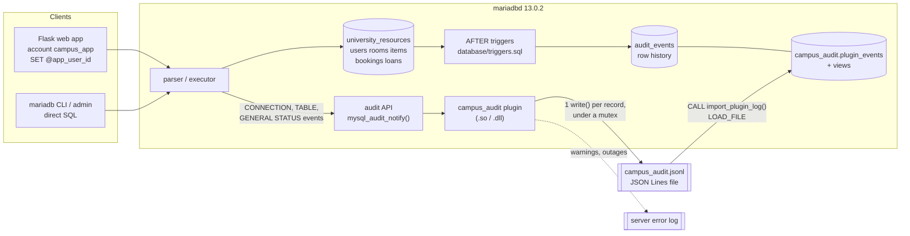
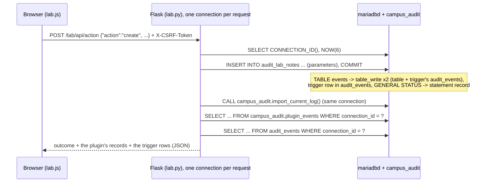
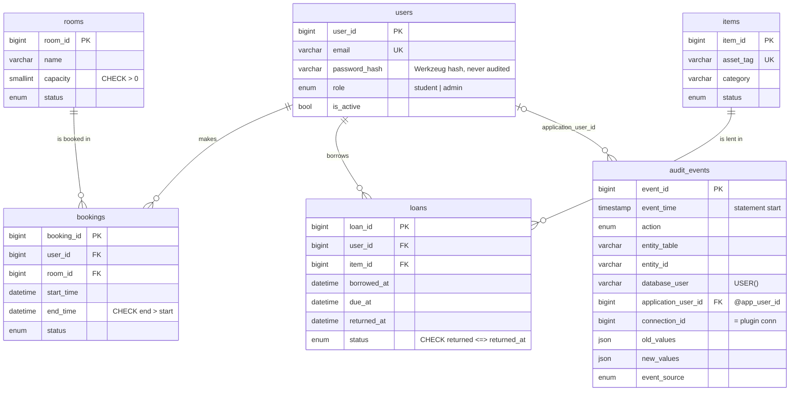

# Architecture

## Components and event flow

1. A client statement reaches the executor.  For every table it opens, the server raises a
   **TABLE LOCK** event (`read_only` tells read from write); DDL raises TABLE CREATE/DROP/RENAME/ALTER.
2. `campus_audit` checks the schema against `campus_audit_databases` and the login against
   `campus_audit_exclude_users`, formats a JSON record (`table_write`, `table_read`, `table_create`, ...)
   and remembers the `query_id` in a hidden per-connection variable.
3. If the statement changes rows of an audited table, an **AFTER trigger** writes the row's old and
   new values into `audit_events` (that write is itself visible to the plugin as a second
   `table_write` with the same `query_id`).
4. After the result or error was sent, the server raises **GENERAL STATUS**.  If this statement
   touched a watched table, the plugin writes one `statement` record: account, default schema,
   error code, and a digest of the SQL with all literals replaced by `?`.  A statement the privilege
   system refused never opened a table; since 1.1.0 it is recorded here as well
   (`"access_denied": true`) when the session's default schema is watched.
5. Logins and `COM_CHANGE_USER` are **CONNECTION** events; by default only failed ones are recorded.
6. An administrator imports the file with `CALL campus_audit.import_plugin_log(@@campus_audit_file_path)`
   and reads `campus_audit.v_table_activity`, `v_row_change_history`, `v_failed_logins` and
   `v_plugin_lifecycle`, or the admin page of the web app.  The web app's account cannot do that
   (no FILE privilege); it calls `campus_audit.import_current_log()`, a definer procedure without
   arguments that can only import the file the plugin is writing (migration 003).

## The Audit Lab path (web app, `/lab`)

The browser only names one of seven allow-listed actions; it never sends SQL.  The actions change
only `audit_lab_notes` rows owned by the signed-in user, except "forbidden statement" (refused by
the server) and "failed database login" (a locked decoy account without privileges).  Students see
the plugin records of their own lab connections (kept in the signed session); administrators can
switch to every record.

The audit callback cannot fail the statement (it returns `void`).  On an I/O error the plugin keeps
the database running (**fail-open**), counts the lost records, retries every 5 s and writes an
`audit_gap` record once the log is writable again.

## Plugin internals

| File | Responsibility |
|---|---|
| `plugin/src/campus_audit.cpp` | Plugin declaration, system/status variables, event handlers, init/deinit, error policy |
| `plugin/src/record_format.cpp` | JSON writer (bounded, UTF-8 validating), SQL digest, name-list parsing, timestamps; no MariaDB headers, unit tested |
| `plugin/src/log_sink.cpp` | Append-only file with `O_APPEND`, one `write()` per record, errno-rich errors |
| `plugin/src/platform.h` | Mutex / reader-writer lock / clock for Linux and Windows |
| `plugin/src/service_symbols.cpp` | Service pointers for builds that cannot link `mysqlservices` (Zig on Windows) |
| `plugin/audit_error.h`, `audit_error_reporter.*`, `audit_file_check.*` | The team's original error-result helpers, now used by the plugin (`AuditResult`, `report_audit_error`, `validate_log_path`) |

Concurrency: event handlers run in many connection threads.  Filters are read under a
reader/writer lock; the file is written under one mutex with a single `write()` per record;
counters are atomics; `seq` is an atomic counter assigned when a record is formatted, so it is
unique per plugin instance but lines can appear slightly out of `seq` order under concurrency.

## Database schema

The separate schema `campus_audit` holds `plugin_events` (one row per imported JSON record,
primary key `(instance_id, seq)`, the full record kept as JSON) and the views.  It has no foreign
keys to `university_resources` on purpose: plugin records are evidence about the server, they must
survive deletion of the rows they describe, and their connection ids are only unique within one
server run.

## Deployment options

| Option | What runs | Verified by us |
|---|---|---|
| A. Native Windows MariaDB 13.0.2 + `campus_audit.dll` (Zig build) | official zip/MSI server, DLL from `plugin/build_windows.ps1` | **yes**: build, load, all integration tests, failure experiments, restart (2026-10-25); plugin 1.1.0, web app, Audit Lab and browser tests again on 2026-11-03 (`docs/evidence/windows-2026-11-03/`) |
| B. Linux container (Docker Desktop on Windows, or Linux) + `campus_audit.so` | `compose.yaml`, image `mariadb:13.0.2-resolute` pinned by digest, plugin compiled in the image | **CI:** Linux Docker Engine, 2026-11-03, build/load/demo/test/examples/browser/restart/stale-volume checks (`docs/evidence/linux-ci-2026-11-03/`). **Manual:** Windows 11 Docker Desktop, 2026-11-09, fresh deployment, demo and test suite; Linux containers from Windows, not Windows CI (`docs/evidence/windows-docker-desktop-2026-11-09/README.md`) |
| C. Linux shared object cross-compiled with Zig | compile check only | compile only; the `.so` that is loaded on Linux is the one built in the Docker image (B) |
